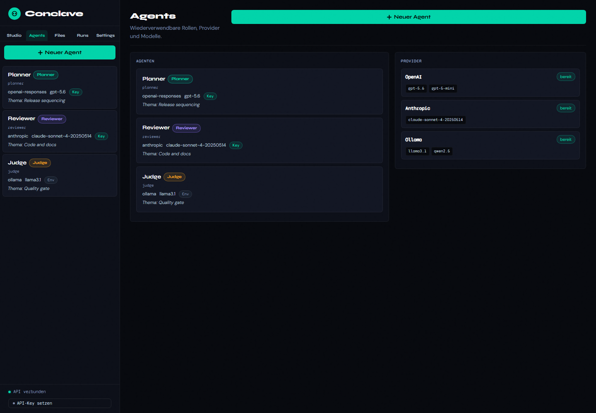

# Personal UI Architektur

## Ziel

Die Conclave-UI ist für ein persönliches Multi-Agent-Arbeitswerkzeug
geschnitten. Statt vieler Funktionen in einem Bedienraum gibt es fünf
fachliche Arbeitsräume.

Die UI ist keine Enterprise-Konsole. Sie ist ein lokales Arbeitsstudio für
einzelne Nutzer.

## Globale Navigation

- Studio
- Agents
- Files (Seitenüberschrift "Workspace")
- Runs
- Settings

Globale Navigation trennt Arbeitsräume. Lokale Navigation strukturiert nur
innerhalb eines Arbeitsraums.

## Sprache

Die Desktop-UI ist mindestens auf Deutsch und Englisch umschaltbar. Die
Sprachauswahl liegt im Sidebar-Footer und wird lokal im Browser unter
`conclave_ui_lang` gespeichert.

Die Umschaltung betrifft die sichtbaren Kernflächen der App:

- globale Navigation
- Sidebar-Panels
- Modale Dialoge
- zentrale Buttons, Placeholder und Hilfetexte
- wichtige dynamische Statusmeldungen und Toasts
- generierte Default-Systemprompts für neue Agentenrollen

API-Fehlermeldungen aus dem Backend können weiterhin im Originaltext des
Servers erscheinen.

## 1. Studio

### Zweck

Studio ist der primäre Arbeitsraum für aktive Conversations.

### Inhalte

- Conversation-Liste
- aktive Session
- Chat-Verlauf
- Participants
- Floor Control
- Invoke und Stream
- Orchestrierung
- Auto-Loop
- Conversation-Regeln
- Kontext-Chip unter jeder Modellantwort (gesendete/ausgelassene Nachrichten,
  Dateien, geschätzte und abgerechnete Token; Klick öffnet die Details)
- Kontext-Vorschau vor dem Aufruf (Bedienleiste sowie Orchestrierungs- und
  Auto-Loop-Dialog pro Teilnehmer), ohne Provider-Aufruf

### Nicht im Studio

- Agent-Konfiguration im Detail
- globale Provider-Verwaltung
- Workspace-Dateiverwaltung
- Usage-Historie
- Backup- oder App-Einstellungen

## 2. Agents



### Zweck

Agents ist der Verwaltungsraum für wiederverwendbare KI-Teilnehmer.

### Inhalte

- Agentenliste
- Agent anlegen, bearbeiten, löschen
- Rolle/System-Prompt
- Provider
- Modell
- API-Key-Status
- Verbindungstest
- Presets
- Kürzungslimit „Max. Nachrichten“ (unter „Erweitert“)

### Rollen

Startrollen:

- Writer
- Reviewer
- Critic
- Researcher
- Planner
- Custom

## 3. Files (Workspace)

### Zweck

Der Bereich "Files" (Seitenüberschrift "Workspace") ist der lokale
Datenraum für Kontext, Notizen und Outputs.

### Inhalte

- Dateibaum (ein vorhandener Ordner `output/` erscheint dort wie jeder
  andere Ordner; eine eigene Output-Ansicht gibt es nicht)
- Datei hochladen oder Text ablegen
- Klick auf einen Dateinamen öffnet die Datei im Viewer unter der Liste
  (nur lesen): Markdown formatiert mit Umschalter „Formatiert / Quelltext“,
  andere Textdateien als Text; „In Chat einfügen“ setzt `@workspace/<pfad>`
  ins Eingabefeld (in der Seitenleiste des Chats fügt ein Klick direkt ein)
- Limit-Chips (UI-, Agent-Lese- und Schreiblimit) und Infotext erklären,
  was Agenten sehen
- Conversation exportieren

Markdown im Viewer wird wie Modellausgaben behandelt: `marked` plus
DOMPurify, unter derselben CSP. Bearbeiten und Löschen gehen nicht über den
Viewer.

### Sicherheitsregeln

- Agenten dürfen nicht aus dem Workspace ausbrechen.
- Versteckte Ordner sind für Agenten unsichtbar.
- Große Dateien werden durch Größenlimits begrenzt (ohne Bestätigungsdialog).
- Kontext wird nicht automatisch vollständig geladen.

## 4. Runs

### Zweck

Runs macht einzelne Modellaufrufe sichtbar, auch die innerhalb von
Orchestrierung und Auto-Loop.

### Inhalte

- Run-Historie: ein Eintrag je Einzelaufruf (Typ `invoke` oder `stream`);
  Orchestrierungen und Auto-Loops erscheinen als ihre einzelnen Aufrufe,
  nicht als eigener Lauf
- Spalten: Start, Status, Typ, Participants, Provider, Tokens, Fehler
- Usage pro Conversation

Dauer und Kosten werden nicht angezeigt.

### Ziel

Der Nutzer sieht, was gelaufen ist, wie viele Tokens es verbraucht hat und
wo ein Aufruf fehlgeschlagen ist.

## 5. Settings

### Zweck

Settings bündelt lokale App-Konfiguration.

### Inhalte

Seite Settings:

- Runtime-Infos (nur lesend): Modus, Server (Host und tatsächlich
  gebundener Port), Datenbank, DB-Pfad, Workspace
- Workspace-Pfad (änderbar)
- Workspace-Limits
- Backup erstellen
- Rate-Limit (änderbar, wird in `config.toml` gespeichert)
- Server-Log mit Filter nach Level

Sidebar:

- Betriebsübersicht (API Auth, Status der Provider-Keys)
- Dialog "API-Zugang" (Conclave-API-Token und Server-URL)
- Sprachauswahl im Sidebar-Footer

Theme-Auswahl und Startmodus gibt es in der UI nicht. Ein Restore ist nur
über CLI (`conclave restore`) oder API (`POST /restore`) möglich.

## Technischer Stand

Die installierten UI-Ressourcen liegen als Package-Data unter
`src/conclave/assets/` (Einstieg `conclave-ui.html`):

```text
src/conclave/assets/static/
  css/
    theme.css
    layout.css
    components.css
  vendor/          # marked, DOMPurify, highlight.js, Swagger UI, Fonts, Lizenzen
  js/
    api.js
    i18n.js
    state.js
    utils.js
    main.js
    swagger-init.js
    features/
      agents.js
      auth.js
      autoloop.js
      context.js
      conversations.js
      export.js
      floor.js
      messages.js
      participants.js
      runs.js
      settings.js
      speech.js
      usage.js
      workspace.js
```

Die UI ist Vanilla-JavaScript ohne Build-Schritt:

- `state.js` hält den zentralen Zustand als Pub/Sub-Objekt (`AppState` mit
  `getState`, `setState`, `subscribe`). Ein Token aus dem URL-Fragment
  (`#token=…`, von `conclave desktop`) wird übernommen und die Adresszeile
  sofort bereinigt.
- `main.js` verteilt Klicks zentral über `data-action`-Attribute
  (Event-Delegation); es gibt keine Inline-Handler.
- `utils.js` enthält `esc()` und `renderMarkdown()`: marked erzeugt HTML,
  DOMPurify filtert es, bevor Modellausgaben angezeigt werden.
- `api.js` sendet das Token als `Authorization: Bearer …`.
- `features/context.js` baut Kontext-Chip, Detailansicht und Vorschau
  ausschließlich mit `createElement`/`textContent` (Dateinamen und Pfade sind
  Nutzerdaten).
- Alle Fremdbibliotheken und Fonts liegen unter `static/vendor/`; es wird
  kein CDN geladen. Der Server setzt eine strikte Content-Security-Policy
  (`script-src 'self'`, `style-src 'self'`, `connect-src 'self'` u.a.).
- `swagger-init.js` initialisiert die API-Dokumentation unter `/api-docs`.

## UX-Regeln

- Erste Ansicht ist Studio.
- Eine primäre Aufgabe pro Screen.
- Keine DSGVO-Begriffe in der Personal-UI.
- Agenten sind schnell testbar.
- Workspace-Referenzen sind sichtbar und per Klick einfügbar.
- Runs zeigen Zeitpunkt, Status, Typ, Participants, Provider, Tokens und Fehler.
- Fehler werden als handlungsnahe Meldungen dargestellt.
